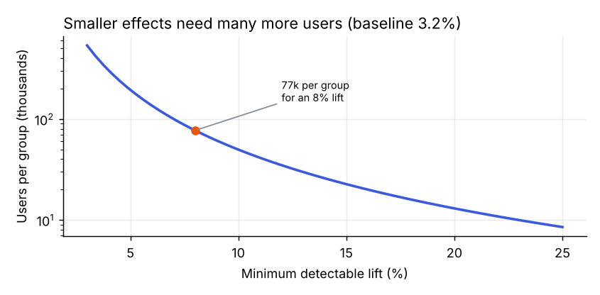
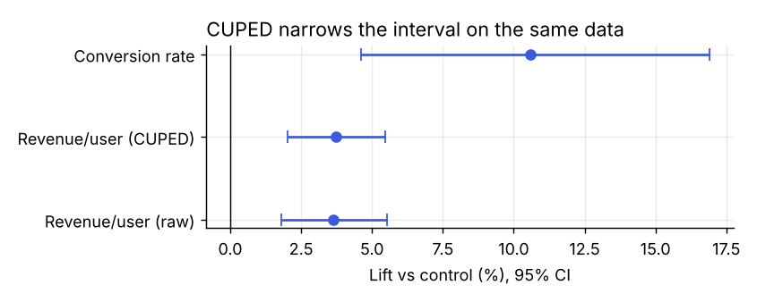
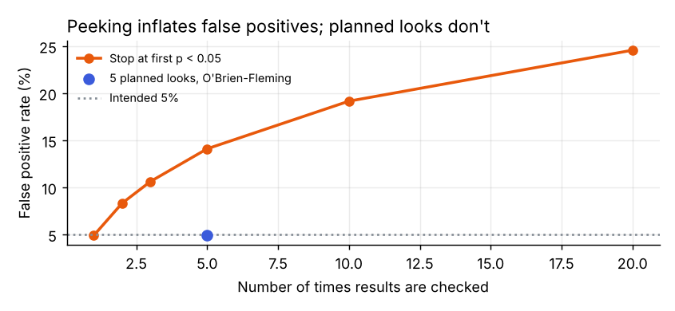

# abtk: a small A/B testing toolkit

The functions I reach for in every marketing or product experiment, in one dependency-light package (numpy + scipy): plan the test, check that it ran correctly, analyze it, and make the call.

**Start here:** [notebooks/ab_test_walkthrough.ipynb](notebooks/ab_test_walkthrough.ipynb) runs a full checkout experiment from planning to the ship decision, including the two mistakes that most often invalidate real tests.

```python
import abtk

abtk.sample_size_proportions(baseline=0.032, mde=0.08)   # (77062, 77062) users per group
abtk.srm_check(n_c=77_062, n_t=77_242)                   # did traffic split as planned?
abtk.proportions_test(2288, 77_062, 2536, 77_242)         # lift, CI, p-value
abtk.bayesian_proportions(2288, 77_062, 2536, 77_242)     # P(B > A), expected loss
abtk.obrien_fleming_bounds(n_looks=5)                     # thresholds for planned interim looks
```

## What's in it

**Plan**
- `sample_size_proportions`, `sample_size_means`: users needed per group, with unequal splits supported
- `power_proportions`, `mde_for_sample`: what a given sample can and can't detect
- `test_duration_days`: runtime from daily traffic, rounded to full weeks so weekday effects even out

**Check**
- `srm_check`: sample ratio mismatch. If this fails, the result is not trustworthy, however good it looks

**Analyze**
- `proportions_test`: two-sided z-test for conversion rates
- `means_test`: Welch's t-test for revenue per user and other continuous metrics
- `cuped`: variance reduction using a pre-experiment covariate
- `bayesian_proportions`: probability that treatment wins, plus the expected loss of each decision

**Look early, safely**
- `obrien_fleming_bounds`: group-sequential z-boundaries for planned interim looks
- `false_positive_rate_with_peeking`: simulates what peeking does to the error rate

Every result reports the absolute difference, the relative lift, and a confidence interval for both. The relative interval uses the delta method on the log scale, so it stays asymmetric the way ratios are.

## Highlights from the walkthrough

**Plan the effect size first.** Halving the detectable lift roughly quadruples the sample.



**Use pre-experiment data.** CUPED removes 16% of the variance in revenue per user, which tightens the interval on the same data, worth about 1.2× the users.



**Don't peek.** Stopping at the first p < 0.05 turns a 5% false positive rate into 14% with five looks and about 25% with twenty. Five planned looks with O'Brien-Fleming boundaries keep it at 5%.



## Install and test

```bash
pip install -e ".[examples]"
make demo        # regenerates the charts
make test        # unit tests
```

The tests check the sample size and the O'Brien-Fleming boundaries against published reference values, that the false positive rate stays at alpha when there is no effect, and that CUPED keeps the mean while reducing variance.

## License

MIT
